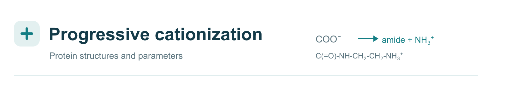

<h1 align="center">cationize-protein</h1>

<picture>
  <source media="(prefers-color-scheme: dark)" srcset="docs/images/banner_dark.svg">
  
</picture>

Build progressively cationized proteins and export their structures and
parameters for Amber, OpenMM or GROMACS.

The script converts carboxyl groups into `-C(=O)-NH-CH₂-CH₂-NH₃⁺`.
It ranks accessible sites by electrostatic potential, rotates each new group
to reduce clashes, minimizes the structure and checks protonation with PROPKA.

- [Install](#install)
- [How it works](#how-it-works)
- [Optional software](#connect-optional-software)
- [Get a structure or sequence](#get-a-structure-or-sequence)
- [Prepare a protein](#prepare-a-protein)
- [Run cationization](#run-cationization)
- [Find your files](#find-your-files)
- [Add a ligand](#add-a-ligand)
- [HSA example](#hsa-example)
- [Options](#options)
- [Software](#software)
- [Residue parameters](#residue-parameters)

## How it works

<picture>
  <source media="(prefers-color-scheme: dark)" srcset="docs/images/hsa_workflow_dark.gif">
  
</picture>

*HSA structures and electrostatic surfaces are shown for each cationization
level. Amidation, minimization and protonation use fixed illustrative examples.
[View the image details](examples/HSA/README.md#figure).*

4K structures, light: [0%](docs/images/hsa_0_4k.png) ·
[25%](docs/images/hsa_25_4k.png) · [50%](docs/images/hsa_50_4k.png) ·
[75%](docs/images/hsa_75_4k.png) · [100%](docs/images/hsa_100_4k.png).
Dark: [0%](docs/images/hsa_0_4k_dark.png) ·
[25%](docs/images/hsa_25_4k_dark.png) · [50%](docs/images/hsa_50_4k_dark.png) ·
[75%](docs/images/hsa_75_4k_dark.png) · [100%](docs/images/hsa_100_4k_dark.png).

## Install

Python 3.12 is recommended. Choose one installation method.

### Python with a local venv

```sh
git clone https://github.com/CalzaAlessandro/cationize-protein.git
cd cationize-protein
python3 install.py
source .venv/bin/activate
cationize-protein doctor
```

The installer creates a local environment and installs the Python dependencies,
including OpenMM, PDBFixer and PROPKA. Activate it with
`source .venv/bin/activate` whenever you open a new terminal. After activation,
use `cationize-protein` directly. Use `deactivate` to leave the environment.

### Conda

With Conda already installed:

```sh
git clone https://github.com/CalzaAlessandro/cationize-protein.git
cd cationize-protein
conda env create -f environment.yml
conda activate cationize-protein
cationize-protein doctor
```

Activate it with `conda activate cationize-protein` in each new terminal.
Use `conda deactivate` to leave it. This route installs the same Python
dependencies without creating a nested `.venv`.

Both methods include everything needed for the default OpenMM minimization,
screened-Coulomb site ranking and ff14SB parameters. Screened Coulomb is an
approximation; choose APBS or PBSA explicitly for Poisson-Boltzmann calculations.

Amber, GROMACS, APBS, MODELLER and ESMFold2 are optional, separate installations.
Installation and `doctor` report whether their code is present; you can add them
later. Neither MODELLER nor ESMFold2 is downloaded by the standard installer.
APBS or Amber PBSA is needed for
Poisson-Boltzmann calculations. GROMACS is only needed to run GROMACS jobs,
not to write its input files. See [installation details](docs/INSTALL.md).

## Connect optional software

PDBFixer, OpenMM, PROPKA and ParmEd are included. Install other tools only
when you need them. The [optional software tutorial](docs/OPTIONAL_SOFTWARE.md)
provides installation commands, configuration and checks for each program,
with Conda and platform-specific alternatives.

| Program | Use | Selection in cationize-protein |
|---|---|---|
| APBS | Poisson-Boltzmann potential | `--solver apbs`; optional executable path with `--apbs` |
| AmberTools / Amber | Serial minimization or PBSA potential | `--engine amber` or `--solver pbsa` |
| GROMACS | Run exported molecular systems | Run GROMACS separately; exports need no GROMACS installation |
| MODELLER | Reconstruct a native protein from template and sequence | `model --method modeller`; requires a MODELLER licence |
| ESMFold2 | Predict a native protein from sequence | `model --method esmfold`; default checkpoint is ESMFold2-Fast |

Executable discovery checks `PATH`, with `AMBERHOME/bin` also checked for Amber
programs. Separate modeling environments can be selected with
`CATIONIZE_MODELLER_PYTHON` or `CATIONIZE_ESMFOLD_PYTHON`. Each variable points
to that environment's Python executable. After connecting a tool, run:

```sh
cationize-protein doctor
```

`doctor` reports available code and executables. Model weights are downloaded
only when an ESMFold2 modeling calculation is requested. MODELLER checks its
licence when modeling starts.

## Get a structure or sequence

Skip this step if you already have your input files. `fetch` accepts a PDB ID,
a UniProt identifier, or both. The two identifiers are independent options.

Download a deposited structure only:

```sh
cationize-protein fetch --pdb 1N5U --output downloaded_pdb
```

This saves `1N5U.pdb` with all deposited chains, models and ligands.

Download a sequence and its UniProt annotations only:

```sh
cationize-protein fetch --uniprot P02768 --output downloaded_sequence
```

This saves `sequence.fasta`, `uniprot.json`, annotated sequence regions and a
table of linked experimental PDB entries. It also saves `mature.fasta` when
UniProt annotates one mature chain with exact boundaries. It does not download
any of the linked structures.

Download both records into one directory:

```sh
cationize-protein fetch --pdb 1N5U --uniprot P02768 --output downloaded
```

This combines the two sets of files. Providing both identifiers retrieves
each record independently; it does not verify that the PDB and UniProt entry
describe the same protein or construct. Every fetch also saves `FETCH.json`
and `fetch.log`, and requires a new output directory.

Choose the sequence of the intended construct; a canonical sequence may
include a signal peptide or propeptide. Select a native protein-only structure
before preparation. See [database retrieval](docs/FETCH.md) for each output.

## Prepare a protein

```sh
cationize-protein prepare input.pdb --output prepared
```

By default, this checks the input, uses PDBFixer to add missing atoms within
existing residues, and assigns histidine charge states with PROPKA at pH 7.4.
OpenMM selects a neutral HID/HIE tautomer when the input does not specify one.
The original PDB is preserved.

```text
prepared/
├── original.pdb
├── protein.pdb
├── preparation.log
├── histidines.csv       When histidines are present
└── protonation/         Detailed PROPKA evidence
```

Missing loops, alternate conformations and malformed coordinate records need
to be resolved before proceeding. The terminal explains what must be fixed.
For inspection without changes, use `cationize-protein check input.pdb`.
See [PDB preparation](docs/PDB_PREPARATION.md) and the
[broken-input examples](examples/pdb_checks/README.md).

To check known disulfide pairs against UniProt, use the downloaded JSON record:

```sh
cationize-protein fetch --uniprot P02768 --output hsa_reference
cationize-protein prepare input.pdb --uniprot-record hsa_reference/uniprot.json \
  --output prepared_with_disulfides
```

The sequence is mapped to the PDB before applying the annotations; residue
numbers are not assumed to match. For mature HSA, UniProt Cys77-Cys86 maps to
Cys53-Cys62. Verified pairs are written as CYX, SSBOND and CONECT records;
thiol HG hydrogens on those pairs are removed. Heavy coordinates are retained.
The output includes `disulfides.csv`, `uniprot_mapping.csv` and the reference
JSON. Ambiguous sequences, conflicting partners and incompatible sulfur
geometry stop preparation. Qualified or alternative-partner annotations require
review; atom serials must be unique. See [supported disulfide assignments](docs/PDB_PREPARATION.md#disulfides-from-uniprot).

### Optional structure modeling

PDBFixer remains the default. If whole residues are missing, an optional
modeler can produce a complete native structural candidate:

```sh
# MODELLER: incomplete native PDB plus its complete sequence
cationize-protein model --method modeller --pdb incomplete.pdb \
  --fasta mature.fasta --output modeled

# ESMFold2-Fast: predict from the complete native sequence
cationize-protein model --method esmfold --fasta mature.fasta --output predicted

# Check and prepare the chosen model before cationization
cationize-protein prepare modeled/protein.pdb --output prepared
```

Use `predicted/protein.pdb` in the last command for an ESMFold2 result.
The ESMFold2 command uses the `biohub/ESMFold2-Fast` checkpoint by default;
add `--esmfold-model full` to select `biohub/ESMFold2`.
MODELLER requires its own licence; local ESMFold2 uses public model weights.
These are full models: their existing regions may differ from the experimental
PDB. Automatic grafting of predicted loops into an otherwise frozen structure
is not implemented. The current modeling interface accepts one native chain.
See [optional modeling](docs/MODELING.md) for installation discovery, outputs
and the current validation limits.

## Run cationization

```sh
cationize-protein run --pdb prepared/protein.pdb --output series
```

The defaults for a new installation are:

| Setting | Default |
|---|---|
| Saved cationization levels | 0%, 25%, 50%, 75% and 100% |
| Minimization engine | OpenMM |
| Electrostatic solver | Screened Coulomb, included |
| Protein force field | ff14SB |
| Protonation | PROPKA at pH 7.4, at baseline and after each chemical step |
| Parameter export | Amber; PDB and OpenMM XML/JSON files are always retained |

Percentages refer to carboxyl groups and are rounded to whole groups. The 0%
baseline is always saved. Introduced ammonium groups remain +1 throughout the
protocol.

For a new run in an interactive terminal, the script asks for any omitted
engine, solver and force field. Press Enter to accept the displayed choice.
Saved installation preferences can change these displayed defaults. A
noninteractive run uses explicit options, then saved preferences, then the
defaults above. A resumed run recovers its recorded scientific choices.

To choose all three settings directly:

```sh
cationize-protein run --pdb prepared/protein.pdb --output series \
  --engine openmm --solver coulomb --force-field ff14SB
```

To save a custom series and export all three formats:

```sh
cationize-protein run --pdb prepared/protein.pdb --output custom_series \
  --percentages 10 25 60 100 --formats amber openmm gromacs
```

This saves 0%, 10%, 25%, 60% and 100%. Each level retains all modifications
made earlier. Available protein force fields are ff14SB, ff19SB and ff99SBildn.

Run the same command again to resume an interrupted calculation. The script
checks the saved inputs and parameters before continuing. Use a new output
directory when changing the protocol. Execution is serial; Slurm is optional.
The calculation ends after minimization, before equilibration or MD production.

## Find your files

```text
series/
├── residue_templates/    Individual residue libraries: ASC.lib, GLC.lib, …
├── 0/
├── 25/
│   ├── protein.pdb      Minimized structure with the actual residue names
│   ├── system.xml       OpenMM system, always retained
│   ├── state.json       Coordinates and chemical state, always retained
│   └── exports/         Parameters and files for the requested engines
├── 50/
├── 75/
├── 100/
└── internal/            Intermediate steps and recovery records
```

| What you need | Where to find it |
|---|---|
| Structure for inspection or docking | `25/protein.pdb` |
| Ready Amber protein | `25/exports/system.parm7` and `system.rst7` |
| Ready OpenMM protein | `25/exports/system.xml` and `state.json` |
| Ready GROMACS protein | `25/exports/system.top`, `system.gro`, `forcefield.itp`, `protein.itp` |
| One modified residue | `residue_templates/ASC.lib`, `GLC.lib`, etc. |
| Complete Amber protein unit | `25/exports/protein.lib` |
| Printed protein parameters | `25/exports/parameters.frcmod` and `PARAMETERS.json` |

The individual `.lib` files use Amber **OFF format**; they do not need duplicate
`.off` copies. `protein.lib` contains the entire protein. `ASC.lib` contains
one residue template. Match the library to the residue's chemical
and terminal state. See [output and parameter reuse](docs/OUTPUTS.md).

## Add a ligand

Start with the cationized `protein.pdb` and an independently parameterized
ligand placed in the same coordinate frame. A ligand PDB alone contains no
force-field parameters.

For Amber, copy one checkpoint's `exports/` folder, keep the atom-type
declarations from `rebuild.in`, and load `parameters.frcmod` plus `protein.lib`.
Load the ligand's compatible parameters and posed coordinates, then use
LEaP's `combine` command. The whole-protein library retains the existing
peptide bonds and disulfides.

For GROMACS, the [short complex tutorial](docs/COMPLEXES.md) provides a Python
script that joins the protein and ligand Amber topologies and writes a
consistent TOP/GRO/ITP set. It also shows where to include an existing ligand
ITP: all global types precede every molecule definition, with one compatible
`[ defaults ]` block. The tutorial uses ff14SB and explains the extra CMAP
requirements for ff19SB.

## HSA example

[examples/HSA](examples/HSA/README.md) contains the existing **585-residue HSA
series** at 0%, 25%, 50%, 75% and 100%, with a PDB, Amber topology and restart
for each minimized structure. Tables list the modified sites and protein
charges. The 17 disulfide bonds are retained at every level.

[View the animated HSA workflow](docs/images/hsa_workflow.gif).

To try the default workflow, use the small peptide example:

```sh
cationize-protein run --pdb examples/pdb_checks/reference_peptide.pdb \
  --output peptide_series --engine openmm --solver coulomb \
  --force-field ff14SB --formats amber openmm gromacs
```

This uses the included screened-Coulomb approximation. Use APBS or PBSA for
a Poisson-Boltzmann calculation.

## Options

### Cationization: `run`

| Flag | Purpose, accepted values and requirements | Default |
|---|---|---|
| <code>--pdb</code> | Native protein PDB; use this or `--topology`, not both. Prepare histidines and incomplete atoms first. | Required unless `--topology` is supplied |
| <code>--topology</code> | Protein-only Amber `parm7`/`prmtop`; requires `--coordinates`. Reading it does not require Amber executables. | Not used |
| <code>--coordinates</code> | Amber `rst7`/`inpcrd` coordinates for `--topology`. | Required with `--topology` |
| <code>--output</code> | New output directory, or the same verified run to resume. Existing results are checked before reuse. | Required |
| <code>--percentages</code> | Saved cumulative levels, for example `25 28 35`; values must be unique and between 0 and 100. Baseline 0% is always saved. | `25 50 75 100` |
| <code>--engine</code> | Minimizer: `openmm` is included; `amber` finds an installed serial `sander` or `pmemd`. `sander` and `pmemd` select that executable directly. | `openmm`* |
| <code>--engine-executable</code> | Path to serial `sander` or `pmemd` for the Amber engine. Requires an existing Amber/AmberTools installation. | Search PATH and AMBERHOME |
| <code>--solver</code> | Potential: `coulomb` is an included screened-Coulomb approximation; `apbs` requires APBS; `pbsa` requires AmberTools/PBSA. | `coulomb`* |
| <code>--apbs</code> | Path to an installed APBS executable; used with `--solver apbs`. | Private installation, PATH, then a saved executable path |
| <code>--pbsa</code> | Path to an installed PBSA executable; used with `--solver pbsa`. | Private installation, PATH, then a saved executable path |
| <code>--force-field</code> | Protein parameters: `ff14SB`, `ff19SB` or `ff99SBildn`. Included through OpenMM; Amber executables are not needed to assign/export them. | `ff14SB`* |
| <code>--formats</code> | Parameter exports: `amber`, `openmm`, `gromacs`; multiple values are accepted. Export does not require the corresponding engine. PDB and OpenMM XML/JSON are always retained. | `amber` |
| <code>--protonation</code> | `propka` checks native protonation before cationization and after each chemical step; `fixed` retains supplied states. PROPKA is included. Introduced ammonium groups remain +1 in both modes. | `propka` |
| <code>--ph</code> | Target pH, from 0 to 14; use the same value in `prepare` and `run`. | `7.4` |
| <code>--probe-radius</code> | Positive probe Lennard-Jones half-Rmin in Å; separate from the PB electrolyte ion radius. | `1.369` Å |
| <code>--parameters</code> | Custom validated residue library directory. | Bundled library |

*For a new interactive run, omitted engine, solver and force field are selected
at a prompt. The table shows fresh-install defaults; saved preferences can
override them. A resumed run uses its recorded settings. External programs
are not installed when a flag is selected: follow [Connect optional software](#connect-optional-software).

### Preparation, retrieval and modeling

| Flag | Purpose, accepted values and requirements | Default |
|---|---|---|
| <code>--uniprot-record</code> | `prepare`: local `uniprot.json` from `fetch`; maps and verifies known intrachain disulfides. No network access is needed during preparation. | Not used; supplied disulfides and geometric detection remain available |
| <code>--protonation</code> | `prepare`: `propka` assigns histidine charge states; `fixed` retains supplied states. PDBFixer, OpenMM and PROPKA are included. | `propka` |
| <code>--ph</code> | `prepare`: pH for initial histidine assignment, from 0 to 14. | `7.4` |
| <code>--pdb</code> | `fetch`: download deposited PDB coordinates; internet access is required. Can be combined with `--uniprot`. | No PDB downloaded unless requested |
| <code>--uniprot</code> | `fetch`: download a UniProt sequence, annotations and disulfide table; internet access is required. Can be used alone. | No UniProt record downloaded unless requested |
| <code>--method</code> | `model`: `modeller` requires an installed MODELLER and its licence; `esmfold` requires a separate ESMFold2/PyTorch environment and model weights. | Required |
| <code>--fasta</code> | `model`: complete native sequence of one chain. | Required |
| <code>--pdb</code> | `model`: incomplete native template for MODELLER. | Required for `modeller`; unused for `esmfold` |
| <code>--python</code> | `model`: Python interpreter containing the chosen optional modeler. | Explicit environment variable, then discovery in the active Python and PATH |
| <code>--esmfold-model</code> | `model`: ESMFold2 checkpoint: `fast` or `full`; both currently use the single-sequence interface. | `fast` |
| <code>--model-revision</code> | `model`: Hugging Face revision; a commit hash pins the weights. | `main` |
| <code>--device</code> | `model`: `auto`, `cpu` or `cuda`; CUDA requires compatible PyTorch and an available NVIDIA GPU. | `auto`: CUDA if available, otherwise CPU |
| <code>--output</code> | Required for `prepare`, `fetch` and `model`; each needs a new directory. | Required |

### Advanced `run` settings

| Flag | Purpose, accepted values and requirements | Default |
|---|---|---|
| <code>--platform</code> | OpenMM platform: `CPU`, `Reference`, `CUDA` or `OpenCL`. GPU platforms require the matching hardware and OpenMM platform. | `CPU` |
| <code>--temperature</code> | Temperature of the electrostatic calculation, in K. | `298` K |
| <code>--solute-dielectric</code> | Protein interior dielectric for PB. | `2` |
| <code>--solvent-dielectric</code> | Solvent dielectric for PB. | `78.5` |
| <code>--salt</code> | Monovalent salt concentration for potential ranking, in M. Minimization uses unscreened GBn2. | `0.15` M |
| <code>--pb-ion-radius</code> | Electrolyte ion radius for PB, in Å. | `2` Å |
| <code>--pb-spacing</code> | Maximum fine-grid spacing for PB, in Å. | `0.75` Å |
| <code>--sampling-spacing</code> | Spacing of the local probe lattice, in Å. | `1` Å |
| <code>--pbsa-nonlinear</code> | Use nonlinear PBSA; requires `--solver pbsa` and installed PBSA. APBS already uses nonlinear PB. | Off; PBSA uses linear ICCG |
| <code>--keep-maps</code> | Keep potential DX maps produced at each APBS step. | Off |
| <code>--beam-width</code> | Number of steric-search candidates retained. | `8` |
| <code>--max-iterations</code> | Maximum iterations per minimization. | `20000` |
| <code>--restraint</code> | Native backbone/disulfide positional restraint strength, in kcal/(mol Ų). | `10` kcal/(mol Ų) |
| <code>--tolerance</code> | Minimization RMS force target, in kcal/(mol Å). | `0.1` kcal/(mol Å) |
| <code>--verbose</code> | Print additional diagnostic messages. | Off |

Use `cationize-protein --help` to list commands, or
`cationize-protein COMMAND --help` for a specific command, for example
`cationize-protein prepare --help`. Installation troubleshooting and
scientific qualification are documented in
[installation](docs/INSTALL.md), [methods](docs/METHODS.md),
[force fields](docs/FORCE_FIELDS.md) and [validation](docs/VALIDATION.md).

This repository is private during development. See [GitHub instructions](docs/GITHUB.md)
for cloning, saving changes and granting collaborator access.

## Software

| Software and official link | Role | Installation |
|---|---|---|
| [OpenMM](https://openmm.org/) | Minimization, molecular systems and hydrogen placement | Included in the Python runtime |
| [PDBFixer](https://github.com/openmm/pdbfixer) | Default repair of missing atoms in native residues | Included |
| [PROPKA](https://github.com/jensengroup/propka) | Initial histidine states and protonation checks after each modification | Included |
| [ParmEd](https://parmed.github.io/ParmEd/html/index.html) | Topology handling and export | Included |
| [Amber / AmberTools](https://ambermd.org/) | Optional Amber minimization and PBSA electrostatics | Separate |
| [GROMACS](https://www.gromacs.org/) | Run exported GROMACS systems | Separate |
| [APBS](https://www.poissonboltzmann.org/) | Poisson-Boltzmann electrostatics | Separate |
| [MODELLER](https://salilab.org/modeller/) | Optional template-based native modeling | Separate; individual licence required |
| [ESMFold2 / ESMFold2-Fast](https://huggingface.co/biohub/ESMFold2) | Optional prediction of native structures from sequence | Separate; [PyTorch](https://pytorch.org/) and compatible [Transformers](https://huggingface.co/docs/transformers/main/model_doc/esmfold2) |

## Residue parameters

The bundled library contains **32 chemical states**, covering modified Asp/Glu
side chains and C termini, with separate terminal, histidine and cysteine
contexts. Four accepted HSA templates (`ASC`, `GLC`, `ASX`, `LET`) retain their
original fitted charges. The other 28 states were developed with capped
amino-acid models:

| Component | How it was obtained |
|---|---|
| Quantum model | ACE/NME caps reproduce the peptide context; disulfide variants include an explicit partner |
| Geometry and electrostatic potential | Two constrained backbone conformations optimized at HF/6-31G(d), with Merz-Kollman ESP samples |
| Partial charges | Joint two-stage RESP fitting, with fixed cap charges and the specified integer residue charge |
| Bonded and Lennard-Jones terms | Amber protein atom types and transfer by chemical analogy |

The introduced ammonium remains +1. The ff14SB, ff19SB and ff99SBildn profiles
share the custom RESP charges and use their corresponding native protein
contexts. New torsional parameters were not fitted.

Each template was checked for connectivity, stereochemistry, charge and
parameter completeness. Fitted capped models were also checked with OpenMM
in vacuum and GBn2. The [validation table](parameters/validation_summary.csv)
records the numerical results.

To extend the library, develop and validate a separate template for each new
chemical state, then supply a complete custom library with `--parameters`.
The [parameter guide](docs/PARAMETERS.md) describes the models, files,
development commands and code changes needed for new chemistry.
