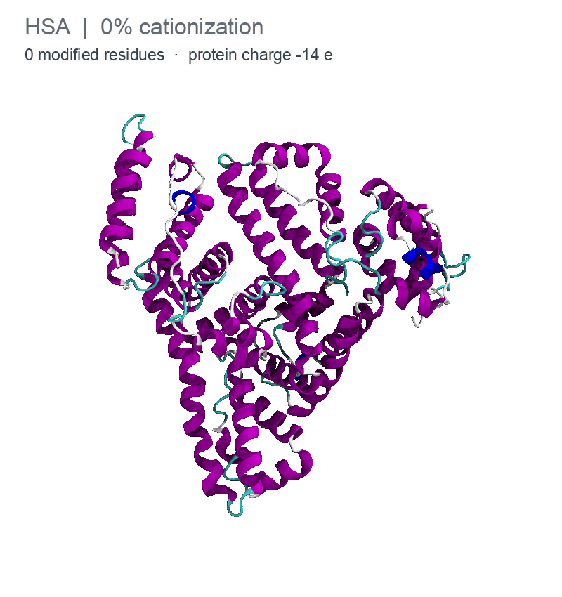
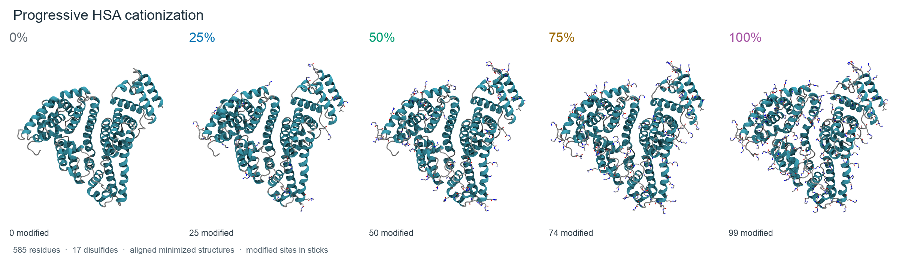

# cationize-protein

Build progressively cationized proteins and export their structures and
parameters for Amber, OpenMM or GROMACS.

<p align="center">
  
</p>

*Progressive HSA cationization: 0%, 25%, 50%, 75% and 100%.
Modified residues are shown as sticks.*

The program converts carboxyl groups into `–C(=O)–NH–CH₂–CH₂–NH₃⁺`.
It selects one site at a time from the electrostatic potential, rotates the
new group to reduce clashes, minimizes the structure and checks protonation
with PROPKA. Each checkpoint retains the modifications made earlier.

[Install](#install) · [Connect optional software](#connect-optional-software) ·
[Get a structure or sequence](#get-a-structure-or-sequence) · [Prepare a protein](#prepare-a-protein) ·
[Run cationization](#run-cationization) · [Find your files](#find-your-files) ·
[HSA example](#hsa-example) · [Options](#options) · [Software](#software)

## Install

Python 3.12 is recommended. From a terminal:

```sh
git clone https://github.com/CalzaAlessandro/cationize-protein.git
cd cationize-protein
python3 install.py
source .venv/bin/activate
cationize-protein doctor
```

The installer creates a local environment and installs the Python dependencies,
including OpenMM, PDBFixer and PROPKA. Activate it with
`source .venv/bin/activate` whenever you open a new terminal. After activation,
use `cationize-protein` directly. Use `deactivate` to leave the environment.

If you prefer Conda, replace the last three commands with:

```sh
conda env create -f environment.yml
conda activate cationize-protein
cationize-protein doctor
```

Amber, GROMACS, APBS, MODELLER and ESMFold2 are optional, separate installations.
Installation and `doctor` report whether their code is present; you can add them
later. Neither MODELLER nor ESMFold2 is downloaded by the standard installer.
APBS or Amber PBSA is needed for
Poisson–Boltzmann calculations. GROMACS is only needed to run GROMACS jobs,
not to write its input files. See [installation details](docs/INSTALL.md).

## Connect optional software

Install only the tools you want to use. PDBFixer, OpenMM, PROPKA and ParmEd
are already included. After adding any external tool, run:

```sh
cationize-protein doctor
```

Replace `/path/to/...` in the examples below with your installation path.
The `export` commands apply to the current terminal. Repeat them in a new
terminal, or add the relevant lines to your shell configuration. On a cluster,
loading the site's software module may already configure these paths.

### APBS: electrostatic potential

Install [APBS using its official instructions](https://apbs.readthedocs.io/en/stable/getting/),
then make the executable visible:

```sh
export PATH="/path/to/apbs/bin:$PATH"
cationize-protein doctor
```

The program also checks its project-private `.tools/apbs/bin/apbs`. APBS is
the default solver. An explicit `--apbs /path/to/apbs` can select one executable
for a run. `--solver coulomb` is an available approximation; it is selected
explicitly rather than used as a fallback when APBS is missing.

### Amber / AmberTools: minimization or PBSA

Obtain [Amber or AmberTools](https://ambermd.org/). Set its installation root:

```sh
export AMBERHOME="/path/to/amber"
export PATH="$AMBERHOME/bin:$PATH"
cationize-protein doctor
```

If the installation provides `amber.sh`, sourcing it also configures its
environment: `source "$AMBERHOME/amber.sh"`. Discovery checks `AMBERHOME/bin`
before `PATH`. Choose `--engine amber` for installed serial `pmemd` or `sander`,
or `--solver pbsa` for Amber PBSA. Amber is not required to export Amber files.

### GROMACS: run the exported topology

Install [GROMACS](https://manual.gromacs.org/current/install-guide/index.html)
and load the environment supplied by that installation:

```sh
source /path/to/gromacs/bin/GMXRC
cationize-protein doctor
```

Alternatively, add its executable directory to `PATH` when its libraries are
already configured. Discovery accepts `gmx` or `gmx_mpi`. GROMACS is used to
run exported systems; it is not a minimization engine inside this program.
Writing `system.top`, `forcefield.itp` and `protein.itp` does not require GROMACS.

### MODELLER: template-based structure reconstruction

Follow the [official MODELLER installation](https://salilab.org/modeller/download_installation.html)
and [licence registration](https://salilab.org/modeller/registration.html).
Detection first checks the active Python, then other Python interpreters on
`PATH`. This includes a compatible Python installed by Homebrew.
To select a particular installation explicitly:

```sh
export CATIONIZE_MODELLER_PYTHON="/path/to/python-with-modeller"
cationize-protein doctor
```

Use the Python executable that can import `modeller`, not the `mod10.x`
launcher or the installation directory. Detection does not validate a licence;
the actual modeling command does. The unrelated PyPI package called `modeller`
is not the official structural modeling software.

### ESMFold2: structure prediction from sequence

Use a separate Python environment for [ESMFold2](https://huggingface.co/biohub/ESMFold2).
Install a [PyTorch build for your CPU or CUDA hardware](https://pytorch.org/get-started/locally/)
in that environment, followed by compatible Transformers and Accelerate:

```sh
python3.12 -m venv .tools/esmfold2-env
source .tools/esmfold2-env/bin/activate
# Install the appropriate PyTorch build using the official instructions above.
python -m pip install "transformers==5.20.1" "accelerate>=1,<2"
deactivate
source .venv/bin/activate
export CATIONIZE_ESMFOLD_PYTHON="$PWD/.tools/esmfold2-env/bin/python"
cationize-protein doctor
```

If `venv` reports that `ensurepip` is missing, [uv](https://docs.astral.sh/uv/getting-started/installation/)
can create the environment with `uv venv --python python3.12 --seed .tools/esmfold2-env`.
With Conda, create a separate Python environment and point the same variable
to its Python. Neither approach requires installing the cationization package
again inside the folding environment. If the main package uses Conda, return
with `conda activate cationize-protein` instead of `source .venv/bin/activate`.

The default is ESMFold2-Fast, which uses the sequence alone. The full checkpoint
can also use an MSA upstream; this program currently exposes single-sequence
prediction for both. Public weights are downloaded on the first explicit
`model --method esmfold` request. `doctor` downloads nothing and no Biohub API
key is needed for this local route. See [modeling commands and requirements](docs/MODELING.md).

## Get a structure or sequence

Skip this step if you already have your input files. `fetch` accepts a PDB ID,
a UniProt identifier, or both. The two identifiers are independent options.

Download a deposited structure only:

```sh
cationize-protein fetch --pdb 1N5U --output downloaded_pdb
```

This saves `1N5U.pdb` with all deposited chains, models and ligands.

Download a sequence and its UniProt annotations only:

```sh
cationize-protein fetch --uniprot P02768 --output downloaded_sequence
```

This saves `sequence.fasta`, `uniprot.json`, annotated sequence regions and a
table of linked experimental PDB entries. It also saves `mature.fasta` when
UniProt annotates one mature chain with exact boundaries. It does not download
any of the linked structures.

Download both records into one directory:

```sh
cationize-protein fetch --pdb 1N5U --uniprot P02768 --output downloaded
```

This combines the two sets of files. Providing both identifiers retrieves
each record independently; it does not verify that the PDB and UniProt entry
describe the same protein or construct. Every fetch also saves `FETCH.json`
and `fetch.log`, and requires a new output directory.

Choose the sequence of the intended construct; a canonical sequence may
include a signal peptide or propeptide. Select a native protein-only structure
before preparation. See [database retrieval](docs/FETCH.md) for each output.

## Prepare a protein

```sh
cationize-protein prepare input.pdb --output prepared
```

By default, this checks the input, uses PDBFixer to add missing atoms within
existing residues, and assigns histidine charge states with PROPKA at pH 7.4.
OpenMM selects a neutral HID/HIE tautomer when the input does not specify one.
The original PDB is preserved.

```text
prepared/
├── original.pdb
├── protein.pdb
├── preparation.log
├── histidines.csv       When histidines are present
└── protonation/         Detailed PROPKA evidence
```

Missing loops, alternate conformations and malformed coordinate records need
to be resolved before proceeding. The terminal explains what must be fixed.
For inspection without changes, use `cationize-protein check input.pdb`.
See [PDB preparation](docs/PDB_PREPARATION.md) and the
[broken-input examples](examples/pdb_checks/README.md).

### Optional structure modeling

PDBFixer remains the default. If whole residues are missing, an optional
modeler can produce a complete native structural candidate:

```sh
# MODELLER: incomplete native PDB plus its complete sequence
cationize-protein model --method modeller --pdb incomplete.pdb \
  --fasta mature.fasta --output modeled

# ESMFold2-Fast: predict from the complete native sequence
cationize-protein model --method esmfold --fasta mature.fasta --output predicted

# Check and prepare the chosen model before cationization
cationize-protein prepare modeled/protein.pdb --output prepared
```

Use `predicted/protein.pdb` in the last command for an ESMFold2 result.
The ESMFold2 command uses the `biohub/ESMFold2-Fast` checkpoint by default;
add `--esmfold-model full` to select `biohub/ESMFold2`.
MODELLER requires its own licence; local ESMFold2 uses public model weights.
These are full models: their existing regions may differ from the experimental
PDB. Automatic grafting of predicted loops into an otherwise frozen structure
is not implemented. The current modeling interface accepts one native chain.
See [optional modeling](docs/MODELING.md) for installation discovery, outputs
and the current validation limits.

## Run cationization

```sh
cationize-protein run --pdb prepared/protein.pdb --output series
```

The defaults for a new installation are:

| Setting | Default |
|---|---|
| Saved cationization levels | 0%, 25%, 50%, 75% and 100% |
| Minimization engine | OpenMM |
| Electrostatic solver | APBS, installed separately |
| Protein force field | ff14SB |
| Protonation | PROPKA at pH 7.4, at baseline and after each chemical step |
| Parameter export | Amber; PDB and OpenMM XML/JSON files are always retained |

Percentages refer to carboxyl groups and are rounded to whole groups. The 0%
baseline is always saved. Introduced ammonium groups remain +1 throughout the
protocol.

For a new run in an interactive terminal, the program asks for any omitted
engine, solver and force field. Press Enter to accept the displayed choice.
Saved installation preferences can change these displayed defaults. A
noninteractive run uses explicit options, then saved preferences, then the
defaults above. A resumed run recovers its recorded scientific choices.

To choose all three settings directly:

```sh
cationize-protein run --pdb prepared/protein.pdb --output series \
  --engine openmm --solver apbs --force-field ff14SB
```

To save a custom series and export all three formats:

```sh
cationize-protein run --pdb prepared/protein.pdb --output custom_series \
  --percentages 10 25 60 100 --formats amber openmm gromacs
```

This saves 0%, 10%, 25%, 60% and 100%. Each level retains all modifications
made earlier. Available protein force fields are ff14SB, ff19SB and ff99SBildn.

Run the same command again to resume an interrupted calculation. The program
checks the saved inputs and parameters before continuing. Use a new output
directory when changing the protocol. Execution is serial; Slurm is optional.
The calculation ends after minimization, before equilibration or MD production.

## Find your files

```text
series/
├── residue_templates/    Individual residue libraries: ASC.lib, GLC.lib, …
├── 0/
├── 25/
│   ├── protein.pdb      Minimized structure with the actual residue names
│   ├── system.xml       OpenMM system, always retained
│   ├── state.json       Coordinates and chemical state, always retained
│   └── exports/         Parameters and files for the requested engines
├── 50/
├── 75/
├── 100/
└── internal/            Intermediate steps and recovery records
```

| What you need | Where to find it |
|---|---|
| Structure for inspection or docking | `25/protein.pdb` |
| Ready Amber protein | `25/exports/system.parm7` and `system.rst7` |
| Ready OpenMM protein | `25/exports/system.xml` and `state.json` |
| Ready GROMACS protein | `25/exports/system.top`, `system.gro`, `forcefield.itp`, `protein.itp` |
| One modified residue | `residue_templates/ASC.lib`, `GLC.lib`, etc. |
| Complete Amber protein unit | `25/exports/protein.lib` |
| Printed protein parameters | `25/exports/parameters.frcmod` and `PARAMETERS.json` |

The individual `.lib` files use Amber **OFF format**; they do not need duplicate
`.off` copies. `protein.lib` contains the entire protein, whereas `ASC.lib`
contains one residue template. Match the library to the residue's chemical
and terminal state. See [output and parameter reuse](docs/OUTPUTS.md).

## HSA example

[examples/HSA](examples/HSA/README.md) contains the existing **585-residue HSA
series** at 0%, 25%, 50%, 75% and 100%, with a PDB, Amber topology and restart
for each minimized structure. Tables list the modified sites and protein
charges. The 17 disulfide bonds are retained at every level.



To try the program without APBS, use the small peptide example:

```sh
cationize-protein run --pdb examples/pdb_checks/reference_peptide.pdb \
  --output peptide_series --engine openmm --solver coulomb \
  --force-field ff14SB --formats amber openmm gromacs
```

This explicitly uses a screened-Coulomb approximation. Use APBS or PBSA for
a Poisson–Boltzmann calculation.

## Options

| Option | Purpose |
|---|---|
| `--percentages 25 28 35` | Save a custom cumulative series |
| `--ph 7.4` | Target pH; use the same value in `prepare` and `run` |
| `--engine openmm` | Minimize with OpenMM; `amber`, `sander` and `pmemd` select installed serial Amber |
| `--solver apbs` | Choose `apbs`, `pbsa` or the `coulomb` approximation |
| `--force-field ff14SB` | Choose ff14SB, ff19SB or ff99SBildn |
| `--formats amber openmm gromacs` | Choose output formats; Amber is the default |
| `--probe-radius 1.369` | Positive probe LJ half-Rmin in Å |
| `--protonation fixed` | Retain supplied protonation states |

Use `cationize-protein --help`, `prepare --help`, `model --help` or `run --help` for the full
command descriptions. Advanced settings, installation troubleshooting and
scientific qualification are documented in
[installation](docs/INSTALL.md), [methods](docs/METHODS.md),
[force fields](docs/FORCE_FIELDS.md) and [validation](docs/VALIDATION.md).

This repository is private during development. See [GitHub instructions](docs/GITHUB.md)
for cloning, saving changes and granting collaborator access.

## Software

| Software and official link | Role | Installation |
|---|---|---|
| [OpenMM](https://openmm.org/) | Minimization, molecular systems and hydrogen placement | Included in the Python runtime |
| [PDBFixer](https://github.com/openmm/pdbfixer) | Default repair of missing atoms in native residues | Included |
| [PROPKA](https://github.com/jensengroup/propka) | Initial histidines and stepwise protonation audit | Included |
| [ParmEd](https://parmed.github.io/ParmEd/html/index.html) | Topology handling and export | Included |
| [Amber / AmberTools](https://ambermd.org/) | Optional Amber minimization and PBSA electrostatics | Separate |
| [GROMACS](https://www.gromacs.org/) | Run exported GROMACS systems | Separate |
| [APBS](https://www.poissonboltzmann.org/) | Poisson–Boltzmann electrostatics | Separate |
| [MODELLER](https://salilab.org/modeller/) | Optional template-based native modeling | Separate; individual licence required |
| [ESMFold2 / ESMFold2-Fast](https://huggingface.co/biohub/ESMFold2) | Optional prediction of native structures from sequence | Separate; [PyTorch](https://pytorch.org/) and compatible [Transformers](https://huggingface.co/docs/transformers/main/model_doc/esmfold2) |

[NumPy](https://numpy.org/) and [SciPy](https://scipy.org/) are included for
numerical calculations. Parameter development can additionally use
[Gaussian](https://gaussian.com/) and AmberTools RESP; neither is needed to use
the bundled residue library. The HSA preview was rendered with
[VMD](https://www.ks.uiuc.edu/Research/vmd/), which is not a runtime dependency.
