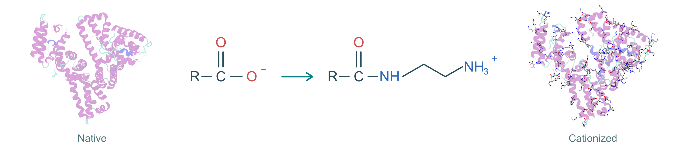
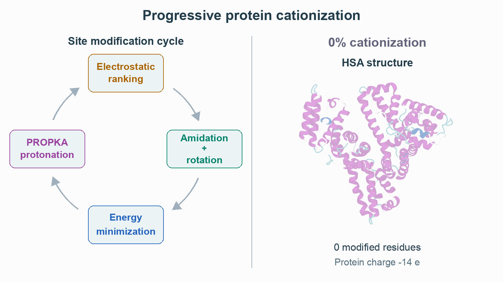

<h1 align="center">cationize-protein</h1>

Build progressively cationized proteins and export structures and parameters
for Amber, OpenMM or GROMACS.

<p align="center">
  <a href="https://doi.org/10.5281/zenodo.24119586"></a>
  <a href="https://github.com/CalzaAlessandro/cationize-protein/actions/workflows/tests.yml"></a>
  <a href="pyproject.toml"></a>
  
  <a href="LICENSE"></a>
</p>

<picture>
  <source media="(prefers-color-scheme: dark)" srcset="docs/images/banner_dark.png">
  
</picture>

## Contents

- [Getting started](#getting-started)
- [Usage and examples](#usage-and-examples)
- [Data and files](#data-and-files)
- [Methods and validation](#methods-and-validation)
- [Documentation](#documentation)
- [Citation](#citation)
- [Contributing](#contributing)
- [Acknowledgements](#acknowledgements)
- [License](#license)

> [!NOTE]
> Parameters, charges and topologies are preliminary.
> See the [validation notes](docs/VALIDATION.md) before using them in simulations.

## Getting started

From the repository root, install the package in a Python 3.12 environment
and run the bundled Asp–Glu–Leu example:

```bash
python3.12 -m venv .venv
source .venv/bin/activate
python -m pip install .
python examples/quickstart/run_quickstart.py --output-dir work/quickstart
```

The example uses OpenMM minimization and the screened-Coulomb solver. Separate
APBS, Amber and GROMACS installations are unnecessary for this run.

[Quickstart and expected outputs](docs/QUICKSTART.md) ·
[Installation guide](docs/INSTALL.md) ·
[Optional software](docs/OPTIONAL_SOFTWARE.md)

## Usage and examples

For your own protein, prepare the structure and then run progressive cationization:

```sh
cationize-protein prepare input.pdb --output prepared
```

```sh
cationize-protein run --pdb prepared/protein.pdb --output series
```

For input retrieval, preparation settings and explicit engine/solver selection,
see the [command reference](docs/REFERENCE.md).

- [HSA series](examples/HSA/README.md): existing structures, parameters and modification tables.
- [Lysozyme walkthrough](docs/REFERENCE.md#lysozyme-walkthrough): retrieval, repair and cationization.
- [All command-line options](docs/REFERENCE.md#options).

## Data and files

| What you need | Where to find it |
|---|---|
| Structure for inspection or docking | `25/protein.pdb` |
| Ready Amber protein | `25/exports/system.parm7` and `system.rst7` |
| Ready OpenMM protein | `25/exports/system.xml` and `state.json` |
| Ready GROMACS protein | `25/exports/system.top`, `system.gro`, `forcefield.itp`, `protein.itp` |
| Single modified residue template | `residue_templates/ASC.lib`, `GLC.lib`, etc. (Amber OFF format) |
| Complete Amber protein unit & parameters | `25/exports/protein.lib`, `parameters.frcmod`, `PARAMETERS.json` |

See [output and parameter reuse](docs/OUTPUTS.md) for the complete file layout,
or [complex assembly](docs/COMPLEXES.md) to add an independently parameterized ligand.

## Methods and validation

Chemical cationization reacts carboxylic acid groups (`Asp` and `Glu` side
chains and the biological C-terminus) with ethylenediamine to form positively
charged aminoethyl-amides (`-C(=O)-NH-CH₂-CH₂-NH₃⁺`), shifting each modified
site from `-1` to `+1` (`Δq = +2 e`).

At each step, `cationize-protein` repeats four operations until all requested
modification percentages (by default `0%`, `25%`, `50%`, `75%` and `100%`) are
reached:

1. **Electrostatic ranking:** computes the electrostatic potential around every
   unmodified carboxyl group and selects the site with the most negative
   accessible potential.
2. **Amidation & steric search:** replaces the selected carboxylate with the
   corresponding validated RESP aminoethyl-amide template and rotates torsional
   bonds to remove steric clashes while preserving the protein backbone and
   disulfides.
3. **Energy minimization:** relaxes the modified structure in implicit solvent
   (GBn2) with positional restraints on the native backbone.
4. **Protonation check:** re-evaluates native titratable residues (`His`, `Asp`,
   `Glu`, `Cys`, `Lys`, `Tyr`) with PROPKA at the target pH while keeping
   introduced ammonium groups protonated (`+1`).

<picture>
  <source media="(prefers-color-scheme: dark)" srcset="docs/images/hsa_workflow_dark.gif">
  
</picture>

*HSA structures and electrostatic surfaces are shown for each cationization
level. Amidation, minimization and protonation use fixed illustrative examples.
[View the image details](examples/HSA/README.md#figure).*

---

The bundled library contains **32 chemical states** covering modified Asp/Glu
side chains and C termini across terminal, histidine and cysteine contexts
([validation summary](parameters/validation_summary.csv), [parameter guide](docs/PARAMETERS.md)).

See [methods](docs/METHODS.md), [residue parameters](docs/PARAMETERS.md)
and [validation notes](docs/VALIDATION.md) for the physical models, fitting
protocol and current scientific limits.

## Documentation

<a id="quick-navigation"></a>
<a id="how-it-works"></a>
<a id="install"></a>
<a id="optional-external-software"></a>
<a id="get-a-structure-or-sequence"></a>
<a id="prepare-a-protein"></a>
<a id="disulfide-verification-from-uniprot"></a>
<a id="optional-structure-modeling-for-missing-loopsresidues"></a>
<a id="run-cationization"></a>
<a id="find-your-files"></a>
<a id="add-a-ligand"></a>
<a id="examples"></a>
<a id="hsa-example"></a>
<a id="lysozyme-walkthrough"></a>
<a id="options"></a>
<a id="software-and-references"></a>
<a id="residue-parameters"></a>

<details>
<summary>Topic index</summary>

- [Quick navigation](#contents)
- [How it works](#methods-and-validation)
- [Install](docs/REFERENCE.md#install)
- [Optional external software](docs/REFERENCE.md#optional-external-software)
- [Get a structure or sequence](docs/REFERENCE.md#get-a-structure-or-sequence)
- [Prepare a protein](docs/REFERENCE.md#prepare-a-protein)
- [Disulfide verification from UniProt](docs/REFERENCE.md#disulfide-verification-from-uniprot)
- [Optional structure modeling for missing loops/residues](docs/REFERENCE.md#optional-structure-modeling-for-missing-loopsresidues)
- [Run cationization](docs/REFERENCE.md#run-cationization)
- [Find your files](docs/REFERENCE.md#find-your-files)
- [Add a ligand](docs/REFERENCE.md#add-a-ligand)
- [Examples](docs/REFERENCE.md#examples)
- [HSA example](docs/REFERENCE.md#hsa-example)
- [Lysozyme walkthrough](docs/REFERENCE.md#lysozyme-walkthrough)
- [Options](docs/REFERENCE.md#options)
- [Software and references](docs/REFERENCE.md#software-and-references)
- [Residue parameters](docs/REFERENCE.md#residue-parameters)

</details>

| Topic | Guide |
|---|---|
| First example | [Quickstart](docs/QUICKSTART.md) |
| Installation | [Install](docs/INSTALL.md) |
| Complete commands and options | [Command reference](docs/REFERENCE.md) |
| Protein preparation | [Preparation](docs/PDB_PREPARATION.md) |
| Parameters and force fields | [Parameters](docs/PARAMETERS.md) · [Force fields](docs/FORCE_FIELDS.md) |
| Output reuse and ligands | [Outputs](docs/OUTPUTS.md) · [Complexes](docs/COMPLEXES.md) |
| External programs | [Optional software](docs/OPTIONAL_SOFTWARE.md) |
| Methods and limitations | [Methods](docs/METHODS.md) · [Validation](docs/VALIDATION.md) |

[Software and primary references](docs/REFERENCE.md#software-and-references).

## Citation

If you use this software or its parameter libraries, cite the archived release:

Alessandro Calza (2026). *cationize-protein*, version 0.1.0.
[DOI: 10.5281/zenodo.24119586](https://doi.org/10.5281/zenodo.24119586).

Citation metadata: [CITATION.cff](CITATION.cff).

<details>
<summary>BibTeX</summary>

```bibtex
@software{Calza2026CationizeProtein,
  author = {Alessandro Calza},
  title = {cationize-protein},
  version = {0.1.0},
  year = {2026},
  doi = {10.5281/zenodo.24119586},
  url = {https://github.com/CalzaAlessandro/cationize-protein}
}
```

</details>

## Contributing

See [CONTRIBUTING.md](CONTRIBUTING.md) for setup and checks. Report problems or propose changes through [GitHub Issues](https://github.com/CalzaAlessandro/cationize-protein/issues). Include the affected file or command and a short description.

## Acknowledgements

This work was developed within the **NanoBio Interface Lab** at the Department
of Chemistry "Giacomo Ciamician," Alma Mater Studiorum – University of Bologna,
and the Preclinical & Translational Research in Oncology lab (PRO), IRCCS
Azienda Ospedaliero–Universitaria di Bologna.

## License

This software, its bundled residue parameter libraries, example structures and
documentation are released under the
[Apache License, Version 2.0 (Apache-2.0)](LICENSE).

See [CITATION.cff](CITATION.cff) for citation metadata. Third-party software and
reference force fields retain their original terms and attribution.
