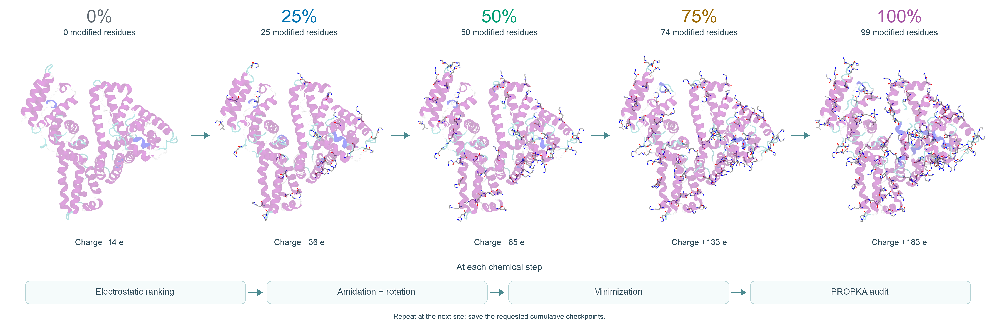

# HSA cationization example

This folder contains the existing **585-residue HSA series** at five
cationization levels. The structures were minimized with the APBS-guided
protocol and renamed using the current residue names. They were produced in the HSA campaign before this CLI release.



## Files

```text
HSA/
├── 1n5u_native_ready.pdb
├── 0/
├── 25/
│   ├── minimized.pdb
│   ├── protein.parm7
│   └── minimized.rst7
├── 50/
├── 75/
├── 100/
├── residue_templates/
├── series_summary.csv
├── modification_sites.csv
└── PROVENANCE.json
```

Each percentage has the same three structure files. The PDB is ready for
inspection. Pair `protein.parm7` with `minimized.rst7` from the **same folder**
to load the parameterized protein. These files describe dry, minimized
structures; they contain no production trajectories.

`residue_templates/` contains the individual custom `.lib` files in Amber OFF
format. `modification_sites.csv` lists every modified residue and identifies
sites added since the preceding checkpoint. `PROVENANCE.json` records source
artifacts, hashes and validation checks without linking to local source paths.

## Series summary

| Cationization | Modified residues | Actual fraction of 99 groups | Protein charge, e | Disulfides |
|---|---:|---:|---:|---:|
| 0% | 0 | 0.00% | −14 | 17 |
| 25% | 25 | 25.25% | +36 | 17 |
| 50% | 50 | 50.51% | +85 | 17 |
| 75% | 74 | 74.75% | +133 | 17 |
| 100% | 99 | 100.00% | +183 | 17 |

Charges are rounded sums of topology partial charges and include the native
protonation states used in the campaign. The topology/PDB atom order,
coordinate agreement, cumulative modification sets and 17 disulfides were
checked at all five levels. Modified-residue charges agree with the distributed
OFF libraries within Amber topology printing precision.

## Residue names

| Name | Original group | Context |
|---|---|---|
| ASC | Asp side-chain carboxyl | Internal residue |
| GLC | Glu side-chain carboxyl | Internal residue |
| ASX | Asp side-chain carboxyl | N-terminal residue |
| LET | C-terminal carboxyl | C-terminal Leu in this HSA model |

The native N-terminal amine is retained in ASX. LET modifies the terminal
carboxyl group; it does not modify the Leu side chain. The complete package
also includes templates for other terminal residue identities.

## Start a new calculation

With the environment activated and from the repository root:

```sh
cationize-protein prepare examples/HSA/1n5u_native_ready.pdb \
  --output hsa_prepared --ph 7.4
cationize-protein run --pdb hsa_prepared/protein.pdb --output hsa_new_series \
  --solver apbs --force-field ff14SB --formats amber openmm gromacs
```

This creates a separate series using the current implementation and initial
histidine assignment. APBS must be installed for this command. It does not
modify the example files or launch MD.

## Figure

All structures are fitted on the same 585 Cα atoms and displayed with one
camera and scale. Protein cartoons are colored by secondary structure;
modified residues appear as heavy-atom sticks. Native backbone aliases are
used only in visualization copies so VMD can recognize the modified residues.
The original example PDB names remain unchanged.

The GIF switches between the five minimized chemical checkpoints. Its frame
sequence represents increasing cationization, not elapsed MD time. Rendering
and alignment details are in
[HSA_PREVIEW.json](../../docs/images/HSA_PREVIEW.json).
