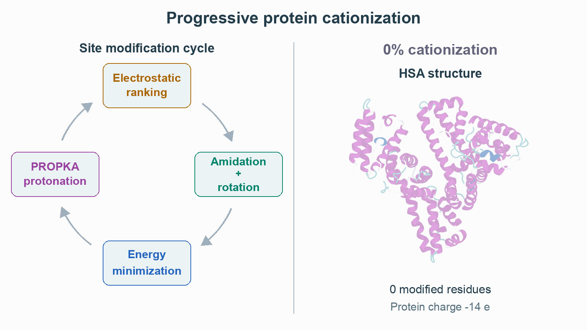
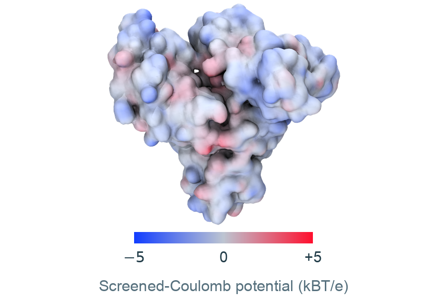
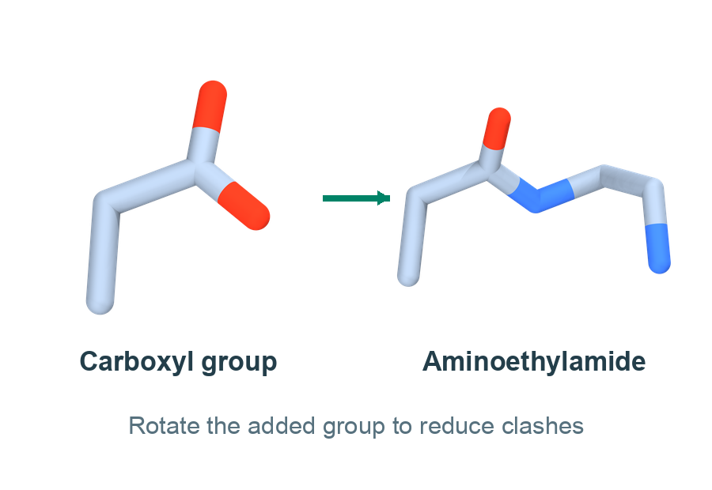
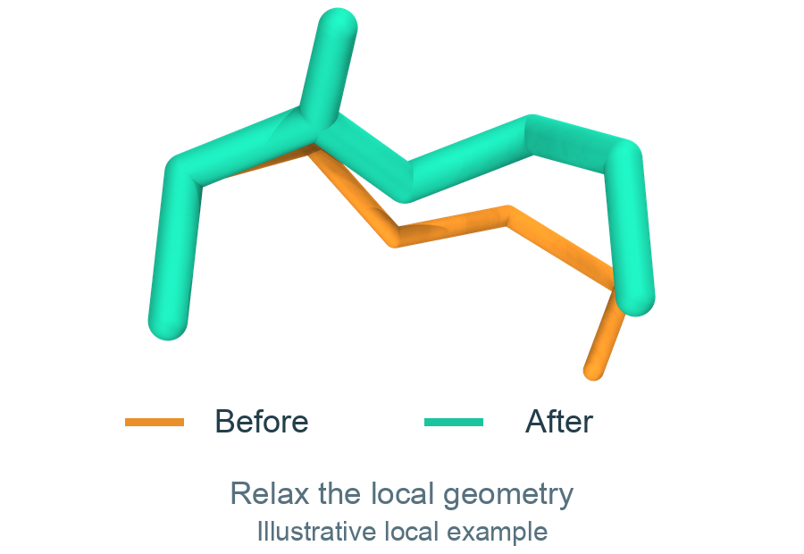
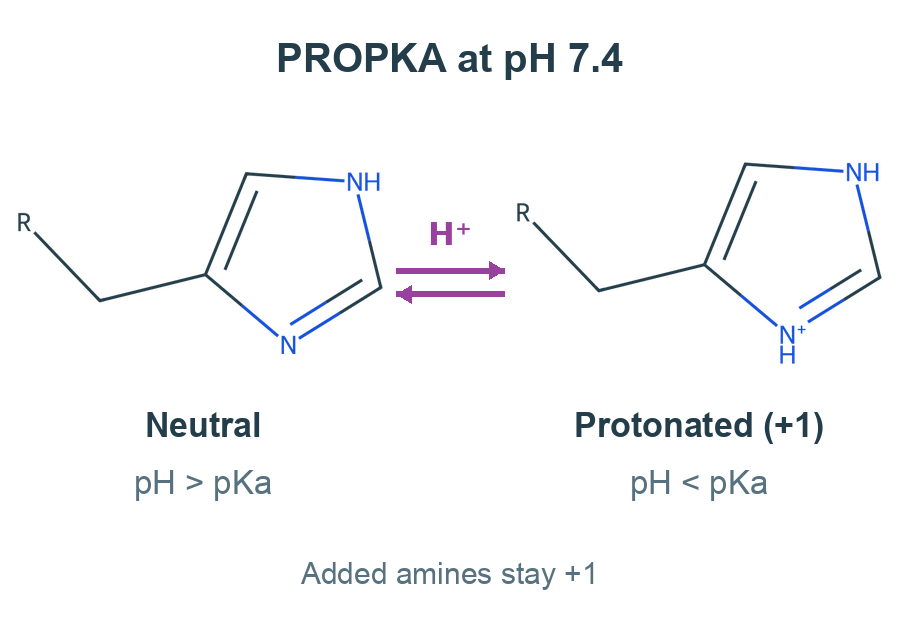

# HSA cationization example

This folder contains the existing **585-residue HSA series** at five
cationization levels. The structures were minimized with the APBS-guided
protocol and renamed using the current residue names. They were produced in the HSA campaign before this CLI release.

<picture>
  <source media="(prefers-color-scheme: dark)" srcset="../../docs/images/hsa_workflow_dark.gif">
  
</picture>

## Files

```text
HSA/
├── 1n5u_native_ready.pdb
├── 0/
├── 25/
│   ├── minimized.pdb
│   ├── protein.parm7
│   └── minimized.rst7
├── 50/
├── 75/
├── 100/
├── residue_templates/
├── series_summary.csv
├── modification_sites.csv
└── PROVENANCE.json
```

Each percentage has the same three structure files. The PDB is ready for
inspection. Pair `protein.parm7` with `minimized.rst7` from the **same folder**
to load the parameterized protein. These files describe dry, minimized
structures; they contain no production trajectories.

`residue_templates/` contains the individual custom `.lib` files in Amber OFF
format. `modification_sites.csv` lists every modified residue and identifies
sites added since the preceding checkpoint. `PROVENANCE.json` records source
artifacts, hashes and validation checks without linking to local source paths.

## Series summary

| Cationization | Modified residues | Actual fraction of 99 groups | Protein charge, e | Disulfides |
|---|---:|---:|---:|---:|
| 0% | 0 | 0.00% | −14 | 17 |
| 25% | 25 | 25.25% | +36 | 17 |
| 50% | 50 | 50.51% | +85 | 17 |
| 75% | 74 | 74.75% | +133 | 17 |
| 100% | 99 | 100.00% | +183 | 17 |

Charges are rounded sums of topology partial charges and include the native
protonation states used in the campaign. The topology/PDB atom order,
coordinate agreement, cumulative modification sets and 17 disulfides were
checked at all five levels. Modified-residue charges agree with the distributed
OFF libraries within Amber topology printing precision.

## Residue names

| Name | Original group | Context |
|---|---|---|
| ASC | Asp side-chain carboxyl | Internal residue |
| GLC | Glu side-chain carboxyl | Internal residue |
| ASX | Asp side-chain carboxyl | N-terminal residue |
| LET | C-terminal carboxyl | C-terminal Leu in this HSA model |

The native N-terminal amine is retained in ASX. LET modifies the terminal
carboxyl group; it does not modify the Leu side chain. The complete package
also includes templates for other terminal residue identities.

## Start a new calculation

With the environment activated and from the repository root:

```sh
cationize-protein prepare examples/HSA/1n5u_native_ready.pdb \
  --output hsa_prepared --ph 7.4
cationize-protein run --pdb hsa_prepared/protein.pdb --output hsa_new_series \
  --solver apbs --force-field ff14SB --formats amber openmm gromacs
```

This creates a separate series using the current implementation and initial
histidine assignment. APBS must be installed for this command. It does not
modify the example files or launch MD.

## Figure

All structures are fitted on the same 585 Cα atoms and displayed with one
camera and scale. The camera is rolled to place the native IIB heart-tip axis
(residues 292-383) vertically. Protein cartoons are colored by secondary structure;
modified residues appear as heavy-atom sticks. Native backbone aliases are
used only in visualization copies so VMD can recognize the modified residues.
The original example PDB names remain unchanged.

The left panel contains the four text labels and highlights the active phase.
The right panel alternates the saved HSA structures and their calculated
potential surfaces with fixed illustrations of amidation, minimization and
protonation. The same three operation examples are repeated in the cycles.
Their heading is **Cationization workflow**. HSA structures and surfaces retain
their percentage labels. Native HSA has no amidation page.

### Electrostatic ranking

<picture>
  <source media="(prefers-color-scheme: dark)" srcset="../../docs/images/cycle_step_potential_dark.png">
  
</picture>

The surface is colored by a screened-Coulomb calculation using the native
topology charges, a solvent dielectric of 78.5, 0.15 M monovalent salt and
298 K. Blue indicates negative potential, silver gray zero and red positive potential. The
display uses the same 3 Å grid and fixed range of −5 to +5 kBT/e for all five
percentages. Each field is calculated from its own checkpoint coordinates
and topology charges. The figure uses screened Coulomb; the saved HSA
cationization series was guided by APBS. Native HSA is shown above; the
animation includes all five surfaces.

### Amidation and rotation

<picture>
  <source media="(prefers-color-scheme: dark)" srcset="../../docs/images/cycle_step_amidation_dark.png">
  
</picture>

The local example illustrates conversion of a carboxyl group into an
aminoethylamide. Rotations of the added group reduce steric overlap before
minimization. Hydrogen atoms are omitted. This illustration is reused for
all cationization levels.

### Energy minimization

<picture>
  <source media="(prefers-color-scheme: dark)" srcset="../../docs/images/cycle_step_minimization_dark.png">
  
</picture>

The same before-and-after overlay illustrates local relaxation in every cycle.
Orange shows the starting geometry and green the relaxed geometry, fitted on
the local backbone. The illustrative coordinates come from a saved local
minimization; displacements retain their original scale.

### PROPKA protonation

<picture>
  <source media="(prefers-color-scheme: dark)" srcset="../../docs/images/cycle_step_protonation_dark.png">
  
</picture>

PROPKA estimates pKa from the protein structure. The histidine example compares
the neutral form (0) with the protonated form (+1). Neutral histidine is favored
when pH is above its pKa; the positive form is favored below it. The scheme
uses pH 7.4, and R marks the connection to the protein backbone. Introduced
amines remain fixed at +1, as shown separately below the equilibrium.

Rendering, source hashes and calculation details are recorded in
[HSA_PREVIEW.json](../../docs/images/HSA_PREVIEW.json).
